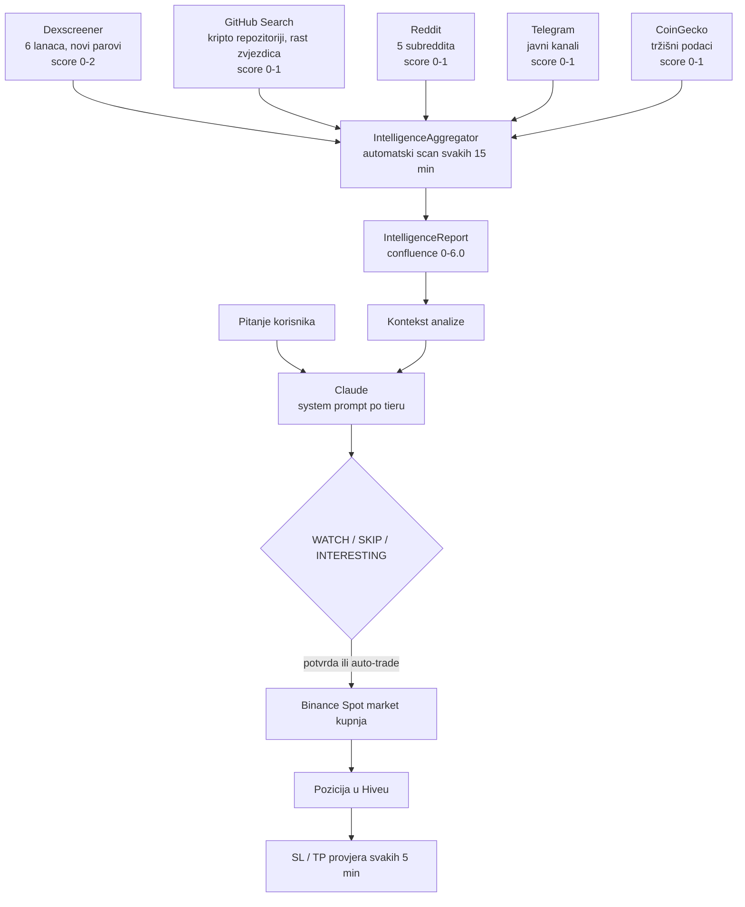

# CoinSight

[English](README.md) | **Hrvatski**

> Android aplikacija za iskusne kripto tradere koja prepoznaje tokene u ranoj fazi kroz pet izvora podataka, analizira ih Claudeom kroz tri investicijska horizonta i izvršava Binance Spot trgovanje sa stop-lossom i take-profitom.

    

## Sadržaj

- [Pregled](#pregled)
- [Kako radi](#kako-radi)
- [Mogućnosti](#mogućnosti)
- [Hardver i preduvjeti](#hardver-i-preduvjeti)
- [Struktura projekta](#struktura-projekta)
- [Pokretanje](#pokretanje)
- [Korištenje](#korištenje)
- [Dokumentacija](#dokumentacija)
- [Status i plan](#status-i-plan)
- [Licenca](#licenca)

## Pregled

Kripto dashboarda ima na tisuće i gotovo svi počinju s Bitcoinom i Ethereumom. Onome tko lovi momentum to je samo šum. Zanimljiva kretanja događaju se ranije i drugdje: token se pojavi na decentraliziranoj burzi, zajednica počne pričati o njemu, GitHub repozitorij skuplja zvjezdice, a tek nekoliko dana kasnije stigne na centraliziranu burzu.

CoinSight je izgrađen oko tog razmaka. Istovremeno prati DEX listinge, GitHub aktivnost, Reddit, javne Telegram kanale i tržišne podatke s CoinGeckoa, spaja ih u jedan confluence score i predaje rezultat Claudeu kao strukturirani kontekst. Claude odgovara kao kolega analitičar, a ne kao učitelj, i svaku kratkoročnu analizu završava jednom od tri ocjene: **WATCH**, **SKIP** ili **INTERESTING**. Ocjena INTERESTING jednim potvrđenim dodirom postaje market kupnja na Binance Spotu, a svaku poziciju zatim čuvaju automatske provjere stop-lossa i take-profita.

Cijela aplikacija organizirana je u tri investicijska horizonta, **SHORT**, **MID** i **LONG**, svaki s vlastitim kontekstom prompta, ekranima, akcijskim gumbima i pohranom. Sve je lokalno: podaci i API ključevi ostaju na uređaju u Hiveu, a aplikacija komunicira samo s API-jima koji su joj potrebni. Trenutna verzija je 8.0.0, s 352 testa koji prolaze i gotovim APK-om.

CoinSight je alat, a ne financijski savjet. Radi isključivo s Binance Spotom (bez futuresa, margine i opcija), a Binance ključ se namjerno izrađuje bez dozvole za isplatu.

## Kako radi

### Tri tiera, jedna aplikacija

**Tier Mode Selector** ispod gornje trake prebacuje cijelu aplikaciju između tri strategije. Podaci svakog tiera čuvaju se u zasebnim Hive boxovima, pa se sve tri mogu koristiti istovremeno.

| | SHORT | MID | LONG |
|---|---|---|---|
| Horizont | Sati do dani | Tjedni do mjeseci | Mjeseci do godine |
| Filozofija | Rani momentum na DEX-u | Otkrivanje vrijednosti prije CEX listinga | Fundamentalno držanje |
| Fokus izvora | DEX listinzi, Telegram, Reddit | GitHub aktivnost, tokenomika | Tim, investitori, partnerstva |
| Izvršenje | Market kupnja s automatskim SL/TP | Ručni ulaz, praćenje projekta | DCA akumulacija |
| Akcijska traka | BUY NOW | CREATE PROJECT | CREATE HOLDING, DCA BUY |
| Tabovi Watchliste | DEX Early, New Listings, My Watchlist, Top Coins | Projekti, Discovery, Watchlist | Holdings, Research, Watchlist |

### Sloj podataka i confluence scoring



`IntelligenceAggregator` pokreće scan svakih 15 minuta. Svaki izvor daje svoj djelomični score, a zbroj se svrstava u kategoriju:

| Confluence score | Kategorija |
|------------------|------------|
| 4,5 ili više | STRONG_INTERESTING |
| 3,0 ili više | POSSIBLE_WATCH |
| 1,5 ili više | WEAK_SIGNAL |
| ispod 1,5 | LIKELY_SKIP |
| manje od 2 aktivna izvora | INSUFFICIENT_DATA |

Izvještaj se oblikuje u strukturirani blok konteksta s detaljima po izvoru i naputkom za scoring te se šalje Claudeu zajedno s pitanjem korisnika.

**Izvori detaljnije:**

- **Dexscreener:** novi parovi na Ethereumu, BSC-u, Solani, Polygonu, Arbitrumu i Baseu, s likvidnošću, volumenom, starošću para i omjerom volumena i likvidnosti.
- **GitHub:** pretraga kripto repozitorija, brzina rasta zvjezdica i nedavni commitovi kao signal legitimnosti.
- **Reddit:** r/CryptoMoonShots, r/altcoin, r/CryptoCurrency, r/defi i r/SatoshiStreetBets, filtrirano po upvoteovima i starosti objave.
- **Telegram:** javni kanali koji se pasivno čitaju preko Bot API-ja, s filtrom ključnih riječi i ocjenom pouzdanosti po kanalu. Bot nikad ništa ne objavljuje.
- **CoinGecko:** tržišni podaci i feed novih listinga, filtrirano na market-cap rang iznad 500 i 24-satni volumen između 50 tisuća i 50 milijuna dolara, čime otpadaju "mrtvi" coinovi i parovi kojima vladaju kitovi.

### Od ocjene do trgovanja

Aplikacija ima dva načina izvršenja. U zadanom načinu s čovjekom u petlji ocjena INTERESTING prikazuje Trade Action Bar; **BUY NOW** otvara dijalog za potvrdu i šalje market kupnju. Svaki prijedlog trgovanja istječe nakon 60 sekundi, pa se potvrda uvijek daje na relevantnoj cijeni. U neobaveznom autonomnom načinu, koji korisnik mora izričito uključiti, bot sam izvršava INTERESTING signale unutar strogih parametara rizika: najveći iznos trgovanja, najveći broj otvorenih pozicija, stop-loss, take-profit i tihi sati.

Binance zahtjevi potpisuju se lokalno HMAC-SHA256 algoritmom; tajni ključ nikad ne napušta uređaj. Aplikacija se usklađuje s Binanceovim vremenom poslužitelja i automatski se ponovno usklađuje pri grešci vremenske oznake, a `LOT_SIZE` korak svakog simbola čita dinamički kako bi količina u nalogu uvijek bila ispravna. Prekidač testnet/live s dijalogom za potvrdu štiti prelazak na pravi novac.

### Grafovi i predikcije

Svaki tier ima graf s vlastitim prozorom povijesti i projekcijom unaprijed. Kad Claudeov odgovor sadrži strukturirani blok predikcije, graf ga iscrtava; inače se projekcija izvodi iz sentimenta ocjene. Predikcije su eksperimentalne i tako su i označene.

| Tier | Povijest | Projekcija |
|------|----------|------------|
| SHORT | 10 dana, po satu | 24 sata |
| MID | 6 mjeseci, po danu | 30 dana |
| LONG | 2 godine, po danu | 6 mjeseci |

### Arhitektura

Kod prati strogu MVVM podjelu s Providerom za stanje:

- **Servisi** rade HTTP, potpisivanje i prikupljanje podataka: CoinGecko, Claude, Binance, Trade, Storage, TelegramMonitor, Dexscreener, GitHubIntelligence, RedditMonitor, IntelligenceAggregator, ChartData, Notification i Wallet.
- **Modeli** drže podatke i stanje, uz četiri `ChangeNotifier` providera: Watchlist, Analysis, Portfolio i Tier.
- **Ekrani** i **widgeti** iscrtavaju sučelje i nikad izravno ne zovu API-je.

Lokalna pohrana koristi devet Hive boxova: `settings`, `watchlist`, `analysis_logs`, `positions`, `monitored_channels_detail`, `mid_term_projects`, `long_term_holdings`, `dex_positions` i `closed_trades`.

## Mogućnosti

### Prikupljanje podataka
- Istovremeno skeniranje pet izvora s confluence scoreom od 0 do 6,0.
- Tab DEX Early s novim parovima na šest lanaca.
- Feed novih listinga s filtrima za ranu fazu.
- Telegram **Bot Manager**: dodavanje, uključivanje i uklanjanje kanala, ocjena pouzdanosti (Novo, Niska, Srednja, Visoka), preporučeni kanali i statistika po kanalu.
- Intelligence dashboard na ekranu Portfolio.

### Analiza
- Claude chat (`claude-sonnet-4`) sa system promptom po tieru i tri predložena pitanja po tieru.
- Strukturirane ocjene WATCH / SKIP / INTERESTING za SHORT, uz lokalni zapis svake analize.

### Trgovanje i portfelj
- Binance Spot market kupnja i prodaja, stanje računa, cijene i povijest naloga preko potpisanog REST-a.
- Automatski stop-loss i take-profit s provjerom svakih 5 minuta.
- Neobavezno autonomno trgovanje s ograničenjima rizika i tihim satima.
- Praćenje DEX pozicija s ručnim unosom i automatskim osvježavanjem cijene.
- WalletConnect v2 (Reown AppKit) za MetaMask, Trust Wallet i slične novčanike.
- **P&L Dashboard:** krivulja kapitala, postotak uspješnih trgovanja, omjer rizika i povrata, raspodjela po tierovima i povijest trgovanja.

### Detaljni ekrani
- **MidProjectDetailScreen:** teza, GitHub podaci, plan ulaza, bilješke.
- **LongHoldingDetailScreen:** četiri taba za osnove, fundamentale, DCA kupnje i bilješke, s praćenjem prosječne cijene.
- **ChartScreen:** graf prilagođen tieru, s projekcijom.
- **DexPositionScreen** i **PnlDashboardScreen**.

### Obavijesti
- Lokalne push obavijesti za pogođeni stop-loss i take-profit te za INTERESTING signale s visokim confluence scoreom.

## Hardver i preduvjeti

| Stavka | Zahtjev |
|--------|---------|
| Uređaj | Android mobitel (glavna platforma); Windows desktop build koristi se za razvoj |
| Flutter | 3.41 ili noviji |
| Dart SDK | `^3.11.4` |
| Android alati | Android SDK preko Android Studija ili command-line alata |

### Servisi i ključevi

Svi ključevi upisuju se u aplikaciji pod **Manage → API / Bot** i čuvaju se samo u lokalnom Hive boxu `settings`. Nikad ne završavaju u izvornom kodu, logovima ni porukama o grešci.

| Servis | Obavezno | Namjena |
|--------|----------|---------|
| Anthropic API ključ | Da | Claude analiza |
| Binance API ključ i tajna | Za trgovanje | Spot trgovanje (ključ izraditi **bez** dozvole za isplatu, po mogućnosti s IP ograničenjem) |
| Telegram Bot token | Preporučeno | Pasivno praćenje kanala |
| GitHub token | Preporučeno | Podiže ograničenje sa 60 na 5000 zahtjeva na sat |
| WalletConnect Project ID | Za DEX novčanike | Povezivanje novčanika |
| CoinGecko, Dexscreener, Reddit | Bez ključa | Besplatni javni endpointi |

### Glavne ovisnosti

`provider`, `hive` / `hive_flutter`, `http`, `fl_chart`, `flutter_local_notifications`, `crypto` (HMAC-SHA256), `reown_appkit` (WalletConnect v2), `intl`. Za razvoj: `flutter_test`, `mocktail`, `hive_generator`, `build_runner`, `flutter_lints`.

## Struktura projekta

```
claude_coinsight/
├── lib/
│   ├── main.dart        ulaz u aplikaciju, navigacija s četiri taba (Watchlist, Analysis, Portfolio, Manage)
│   ├── models/          podatkovni modeli i četiri ChangeNotifier providera
│   ├── services/        API klijenti, trgovanje, izvori podataka, pohrana, obavijesti, novčanik
│   ├── screens/         watchlist, analiza, portfelj, postavke, bot manager, detaljni ekrani i grafovi
│   ├── widgets/         kartica coina, chat oblačić, grafovi, odabir tiera, tabovi postavki
│   └── theme/           tamna tema
├── test/                unit, widget i integracijski testovi (352)
├── assets/              gotov APK (coinsight-v8.0.0.apk)
├── android/             Android projekt (mape ostalih platformi su samo predložak)
├── archive/             specifikacije sesija i raniji dokumenti
├── OVERVIEW.md          cjelovita tehnička arhitektura i povijest
├── MANUAL.md            korisnički priručnik
├── NEWBIE_GUIDE.md      vodič za početnike
└── WORKLOG.md           dnevnik razvoja
```

## Pokretanje

### Instalacija APK-a

1. Kopiraj `assets/coinsight-v8.0.0.apk` na mobitel.
2. Dopusti instalaciju iz nepoznatih izvora kad Android to zatraži.
3. Instaliraj i otvori aplikaciju.

### Build iz izvornog koda

```bash
git clone https://github.com/nroxa92/claude_coinsight.git
cd claude_coinsight
flutter pub get
flutter build apk --debug
```

### Provjera

```bash
flutter analyze      # očekivano: bez problema
flutter test         # očekivano: 352/352 prolazi
```

## Korištenje

1. **Upiši ključeve** u **Manage → API**: prvo Anthropic, zatim Binance ako želiš trgovati. Gumbom **Test** provjeri vezu; uspješan Binance test javlja USDT stanje i odmak vremena poslužitelja.
2. **Odaberi tier** preko Tier Mode Selectora. Cijela aplikacija se prilagodi.
3. **Pronađi kandidate** u **Watchlisti**: DEX Early i New Listings za SHORT, Discovery za MID, Research za LONG.
4. **Analiziraj** coin u **Analysis**. Izvještaj iz izvora podataka dodaje se automatski; postavi svoje pitanje ili dodirni predloženo.
5. **Djeluj** iz akcijske trake: BUY NOW za SHORT, CREATE PROJECT za MID, CREATE HOLDING ili DCA BUY za LONG.
6. **Prati** pozicije, intelligence dashboard i P&L dashboard u **Portfoliju**.
7. **Podesi** parametre rizika u **Manage → Trade** i Telegram kanale u **Manage → Bot**.

Za prvu sesiju s pravim novcem dokumentacija preporučuje oprezna ograničenja: najviše 5 USDT po trgovanju, jedna otvorena pozicija, stop-loss na 10 %, auto-trade isključen.

### Tabovi u Manageu

| Tab | Sadržaj |
|-----|---------|
| API | Pristupni podaci za Anthropic, Binance (testnet/live), GitHub i WalletConnect |
| Tiers | Zasebne postavke za SHORT, MID i LONG |
| Bot | Telegram bot token i upravljanje kanalima |
| Trade | Parametri rizika, prekidač za auto-trade, tihi sati |
| App | Brisanje povijesti analiza, izvoz logova u međuspremnik, reset svih postavki |

## Dokumentacija

| Dokument | Sadržaj |
|----------|---------|
| [NEWBIE_GUIDE.md](NEWBIE_GUIDE.md) | Vodič korak po korak za nove korisnike, uključujući otvaranje računa i ključeva |
| [MANUAL.md](MANUAL.md) | Cjeloviti korisnički priručnik i česta pitanja |
| [OVERVIEW.md](OVERVIEW.md) | Tehnička arhitektura, tok podataka, sigurnosni model, povijest verzija, poznati problemi |
| [WORKLOG.md](WORKLOG.md) | Dnevnik razvoja po sesijama |
| [test/README.md](test/README.md) | Raspored testova, pokrivenost po slojevima i obrasci testiranja |

## Status i plan

**Radi (v8.0.0):** sloj s pet izvora podataka, Claude analiza po tieru, Binance Spot trgovanje sa SL/TP i neobaveznim auto-tradeom, Telegram Bot Manager, upravljanje MID projektima i LONG pozicijama, praćenje DEX pozicija, grafovi s projekcijama, push obavijesti, P&L dashboard i WalletConnect v2. `flutter analyze` je čist, a svih 352 testa prolazi.

| Verzija | Prekretnica |
|---------|-------------|
| 1.0.0 | MVP: CoinGecko, Claude, Hive, New Listings |
| 2.0.0 | Binance, Telegram monitor, Portfolio |
| 2.1.0 | Ispravci za LOT_SIZE i vremensku oznaku, Bot Manager |
| 3.0.0 | Sloj podataka: DEX, GitHub, Reddit agregacija |
| 4.0.0 | Okvir s tri investicijska tiera |
| 5.0.0 | Detaljni ekrani i praćenje DEX pozicija |
| 6.0.0 | Grafovi i push obavijesti |
| 7.0.0 | P&L dashboard i WalletConnect v2 |
| 8.0.0 | Sređena dokumentacija, vlasnička licenca, testovi prošireni na 352 |

**Poznata ograničenja:**

- Još nije izvršen nijedan pravi Binance nalog; testiranje uživo čeka na developerov Binance račun.
- Stop-loss i take-profit rade unutar aplikacije s provjerom svakih 5 minuta, pa se ne aktiviraju dok je aplikacija zatvorena. Planirani su stop nalozi na strani poslužitelja.
- DEX pozicije ne mogu se prodati automatski; aplikacija upozori, a korisnik zatvara poziciju na DEX-u.
- Besplatna razina CoinGeckoa ograničava povijest, pa LONG grafovi za manje coinove mogu biti nepotpuni.
- Predikcije na grafovima su eksperimentalne i nisu provjerene backtestom.
- WalletConnect sesija se nakon potpunog zatvaranja aplikacije ponovno uspostavlja.
- iOS build nije napravljen ni testiran.

**Sljedeći kandidati:** ekrani za povijest naloga i log analiza, Reddit OAuth2, trajna povijest izvještaja za praćenje trendova, generirani Hive type adapteri, WebSocket streaming cijena, backtest način rada, izvoz u CSV.

## Licenca

Objavljeno pod [MIT licencom](LICENSE) — slobodno za korištenje, izmjene i dijeljenje.
