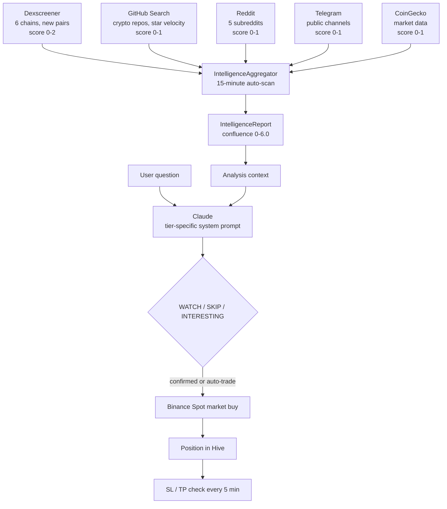

# CoinSight

**English** | [Hrvatski](README.hr.md)

> An Android app for experienced crypto traders that spots early-stage tokens across five intelligence sources, analyses them with Claude through three investment horizons, and executes Binance Spot trades with stop-loss and take-profit.

    

## Contents

- [Overview](#overview)
- [How It Works](#how-it-works)
- [Features](#features)
- [Hardware / Requirements](#hardware--requirements)
- [Project Structure](#project-structure)
- [Getting Started](#getting-started)
- [Usage](#usage)
- [Documentation](#documentation)
- [Status & Roadmap](#status--roadmap)
- [License](#license)

## Overview

There are thousands of crypto dashboards, and almost all of them lead with Bitcoin and Ethereum. For someone hunting momentum, those are noise. The interesting moves happen earlier and elsewhere: a token appears on a decentralised exchange, a community starts talking about it, a GitHub repository gains stars, and only days later does it reach a centralised exchange.

CoinSight is built around that gap. It watches DEX listings, GitHub activity, Reddit, public Telegram channels and CoinGecko market data at the same time, combines them into a single confluence score, and hands the result to Claude as structured context. Claude answers as a fellow analyst, not a tutor, and ends every short-term analysis with one of three verdicts: **WATCH**, **SKIP** or **INTERESTING**. An INTERESTING verdict can be turned into a Binance Spot market buy with one confirmed tap, and every position is then guarded by automatic stop-loss and take-profit checks.

The whole app is organised into three investment horizons, **SHORT**, **MID** and **LONG**, each with its own prompt context, screens, action buttons and storage. Everything is local-first: all data and API keys stay on the device in Hive, and the app talks only to the APIs it needs. The current version is 8.0.0, with 352 passing tests and a release APK.

CoinSight is a tool, not financial advice. It deals only in Binance Spot (no futures, margin or options), and its Binance key is deliberately created without withdrawal permission.

## How It Works

### Three tiers, one app

A **Tier Mode Selector** under the app bar switches the entire app between three strategies. Data for each tier is kept in separate Hive boxes, so all three can run side by side.

| | SHORT | MID | LONG |
|---|---|---|---|
| Horizon | Hours to days | Weeks to months | Months to years |
| Philosophy | Early momentum on DEX | Value discovery before CEX listing | Fundamental hold |
| Intelligence focus | DEX listings, Telegram, Reddit | GitHub activity, tokenomics | Team, investors, partnerships |
| Execution | Market buy with automatic SL/TP | Manual entry, project tracking | DCA accumulation |
| Action bar | BUY NOW | CREATE PROJECT | CREATE HOLDING, DCA BUY |
| Watchlist tabs | DEX Early, New Listings, My Watchlist, Top Coins | Projects, Discovery, Watchlist | Holdings, Research, Watchlist |

### Intelligence layer and confluence scoring



The `IntelligenceAggregator` runs a scan every 15 minutes. Each source contributes its own partial score, and the sum is categorised:

| Confluence score | Category |
|------------------|----------|
| 4.5 or more | STRONG_INTERESTING |
| 3.0 or more | POSSIBLE_WATCH |
| 1.5 or more | WEAK_SIGNAL |
| below 1.5 | LIKELY_SKIP |
| fewer than 2 active sources | INSUFFICIENT_DATA |

The report is formatted into a structured context block with per-source detail and a scoring hint, then sent to Claude together with the user's question.

**Sources in detail:**

- **Dexscreener:** new pairs on Ethereum, BSC, Solana, Polygon, Arbitrum and Base, with liquidity, volume, pair age and volume-to-liquidity ratio.
- **GitHub:** crypto repository search, star velocity and recent commits as a legitimacy signal.
- **Reddit:** r/CryptoMoonShots, r/altcoin, r/CryptoCurrency, r/defi and r/SatoshiStreetBets, filtered by upvotes and post age.
- **Telegram:** public channels read passively through the Bot API, with keyword filtering and a per-channel reliability score. The bot never posts.
- **CoinGecko:** market data and the New Listings feed, filtered to market-cap rank above 500 and 24 h volume between $50k and $50M, which removes ghost coins and whale-dominated pairs.

### From verdict to trade

The app supports two execution modes. In the default human-in-the-loop mode, an INTERESTING verdict shows the Trade Action Bar; **BUY NOW** opens a confirmation dialog and places a market buy. Each trade proposal expires after 60 seconds so that confirmation always happens at a relevant price. In the optional autonomous mode, explicitly enabled by the user, the bot executes INTERESTING signals itself within strict risk parameters: maximum trade amount, maximum open positions, stop-loss, take-profit and quiet hours.

Binance requests are signed locally with HMAC-SHA256; the secret never leaves the device. The app syncs with Binance server time and resyncs automatically on timestamp errors, and it reads each symbol's `LOT_SIZE` step dynamically so order quantities are always valid. A testnet/live switch with a confirmation dialog guards the move to real money.

### Charts and predictions

Each tier has a chart with its own history window and a forward projection. When Claude's answer contains a structured prediction block, the chart draws it; otherwise a sentiment-based projection is derived from the verdict. Predictions are experimental and labelled as such.

| Tier | History | Projection |
|------|---------|------------|
| SHORT | 10 days, hourly | 24 hours |
| MID | 6 months, daily | 30 days |
| LONG | 2 years, daily | 6 months |

### Architecture

The code follows a strict MVVM layering with Provider for state:

- **Services** handle HTTP, signing and intelligence: CoinGecko, Claude, Binance, Trade, Storage, TelegramMonitor, Dexscreener, GitHubIntelligence, RedditMonitor, IntelligenceAggregator, ChartData, Notification and Wallet.
- **Models** hold data and state, plus four `ChangeNotifier` providers: Watchlist, Analysis, Portfolio and Tier.
- **Screens** and **widgets** render the UI and never call APIs directly.

Local storage uses nine Hive boxes: `settings`, `watchlist`, `analysis_logs`, `positions`, `monitored_channels_detail`, `mid_term_projects`, `long_term_holdings`, `dex_positions` and `closed_trades`.

## Features

### Intelligence
- Simultaneous scanning of five sources with confluence scoring from 0 to 6.0.
- DEX Early tab with new pairs across six chains.
- New Listings feed with early-stage filters.
- Telegram **Bot Manager**: add, enable and remove channels, reliability rating (New, Low, Medium, High), recommended channels and per-channel statistics.
- Intelligence dashboard in the Portfolio screen.

### Analysis
- Claude chat (`claude-sonnet-4`) with a tier-specific system prompt and three suggestion chips per tier.
- Structured WATCH / SKIP / INTERESTING verdicts for SHORT, with every analysis logged locally.

### Trading and portfolio
- Binance Spot market buy and sell, balance, prices and order history over signed REST.
- Automatic stop-loss and take-profit on a 5-minute monitoring tick.
- Optional autonomous trading with risk limits and quiet hours.
- DEX position tracking with manual entry and automatic price refresh.
- WalletConnect v2 (Reown AppKit) for MetaMask, Trust Wallet and similar wallets.
- **P&L Dashboard:** equity curve, win rate, risk/reward ratio, per-tier breakdown and trade history.

### Detail screens
- **MidProjectDetailScreen:** thesis, GitHub data, entry plan, notes.
- **LongHoldingDetailScreen:** four tabs for basics, fundamentals, DCA purchases and notes, with average-price tracking.
- **ChartScreen:** tier-aware chart with projection.
- **DexPositionScreen** and **PnlDashboardScreen**.

### Notifications
- Local push alerts for stop-loss and take-profit hits and for high-confluence INTERESTING signals.

## Hardware / Requirements

| Item | Requirement |
|------|-------------|
| Device | Android phone (primary target); Windows desktop build used for development |
| Flutter | 3.41 or newer |
| Dart SDK | `^3.11.4` |
| Android toolchain | Android SDK via Android Studio or command-line tools |

### Services and keys

All keys are entered in **Manage → API / Bot** inside the app and stored only in the local Hive `settings` box. None are ever placed in source code, logs or error messages.

| Service | Required | Used for |
|---------|----------|----------|
| Anthropic API key | Yes | Claude analysis |
| Binance API key and secret | For trading | Spot trading (create the key **without** withdrawal permission, ideally IP-restricted) |
| Telegram Bot token | Recommended | Passive channel monitoring |
| GitHub token | Recommended | Raises the rate limit from 60 to 5000 requests per hour |
| WalletConnect Project ID | For DEX wallets | Wallet linking |
| CoinGecko, Dexscreener, Reddit | No key | Free public endpoints |

### Main dependencies

`provider`, `hive` / `hive_flutter`, `http`, `fl_chart`, `flutter_local_notifications`, `crypto` (HMAC-SHA256), `reown_appkit` (WalletConnect v2), `intl`. Dev: `flutter_test`, `mocktail`, `hive_generator`, `build_runner`, `flutter_lints`.

## Project Structure

```
claude_coinsight/
├── lib/
│   ├── main.dart        app entry, four-tab navigation (Watchlist, Analysis, Portfolio, Manage)
│   ├── models/          data models and the four ChangeNotifier providers
│   ├── services/        API clients, trading, intelligence sources, storage, notifications, wallet
│   ├── screens/         watchlist, analysis, portfolio, settings, bot manager, detail and chart screens
│   ├── widgets/         coin card, chat bubble, charts, tier selector, settings tabs
│   └── theme/           dark theme
├── test/                unit, widget and integration tests (352)
├── assets/              release APK (coinsight-v8.0.0.apk)
├── android/             Android project (other platform folders are scaffolding)
├── archive/             session specifications and earlier documents
├── OVERVIEW.md          full technical architecture and history
├── MANUAL.md            user manual
├── NEWBIE_GUIDE.md      beginner's guide
└── WORKLOG.md           development log
```

## Getting Started

### Install the APK

1. Copy `assets/coinsight-v8.0.0.apk` to the phone.
2. Allow installation from unknown sources when Android asks.
3. Install and open the app.

### Build from source

```bash
git clone https://github.com/nroxa92/claude_coinsight.git
cd claude_coinsight
flutter pub get
flutter build apk --debug
```

### Verify

```bash
flutter analyze      # expected: no issues
flutter test         # expected: 352/352 passed
```

## Usage

1. **Configure keys** in **Manage → API**: Anthropic first, then Binance if you intend to trade. Use **Test** to check the connection; a successful Binance test reports the USDT balance and the server time offset.
2. **Pick a tier** with the Tier Mode Selector. The whole app adapts.
3. **Find candidates** in **Watchlist**: DEX Early and New Listings for SHORT, Discovery for MID, Research for LONG.
4. **Analyse** a coin in **Analysis**. The intelligence report is attached automatically; ask your own questions or tap a suggestion chip.
5. **Act** from the action bar: BUY NOW for SHORT, CREATE PROJECT for MID, CREATE HOLDING or DCA BUY for LONG.
6. **Monitor** positions, the intelligence dashboard and the P&L dashboard in **Portfolio**.
7. **Tune** risk parameters in **Manage → Trade** and Telegram channels in **Manage → Bot**.

For a first live session, the documentation recommends conservative limits: maximum trade 5 USDT, one open position, stop-loss at 10 %, auto-trade off.

### Manage tabs

| Tab | Content |
|-----|---------|
| API | Anthropic, Binance (testnet/live), GitHub and WalletConnect credentials |
| Tiers | Separate settings for SHORT, MID and LONG |
| Bot | Telegram bot token and channel management |
| Trade | Risk parameters, auto-trade switch, quiet hours |
| App | Clear analysis history, export logs to clipboard, reset all settings |

## Documentation

The documents are in Croatian.

| Document | Content |
|----------|---------|
| [NEWBIE_GUIDE.md](NEWBIE_GUIDE.md) | Step-by-step guide for new users, including account and key setup |
| [MANUAL.md](MANUAL.md) | Complete user manual and FAQ |
| [OVERVIEW.md](OVERVIEW.md) | Technical architecture, data flow, security model, version history, known issues |
| [WORKLOG.md](WORKLOG.md) | Session-by-session development log |
| [test/README.md](test/README.md) | Test layout, coverage by layer and testing patterns |

## Status & Roadmap

**Working (v8.0.0):** five-source intelligence layer, Claude analysis per tier, Binance Spot trading with SL/TP and optional auto-trade, Telegram Bot Manager, MID and LONG project and holding management, DEX position tracking, charts with projections, push notifications, P&L dashboard and WalletConnect v2. `flutter analyze` is clean and all 352 tests pass.

| Version | Milestone |
|---------|-----------|
| 1.0.0 | MVP: CoinGecko, Claude, Hive, New Listings |
| 2.0.0 | Binance, Telegram monitor, Portfolio |
| 2.1.0 | LOT_SIZE and timestamp fixes, Bot Manager |
| 3.0.0 | Intelligence layer: DEX, GitHub, Reddit aggregation |
| 4.0.0 | Three-tier investment framework |
| 5.0.0 | Detail screens and DEX position tracking |
| 6.0.0 | Charts and push notifications |
| 7.0.0 | P&L dashboard and WalletConnect v2 |
| 8.0.0 | Documentation overhaul, proprietary license, test suite expanded to 352 |

**Known limitations:**

- No live Binance order has been executed yet; live testing is pending on the developer's Binance account.
- Stop-loss and take-profit run inside the app on a 5-minute tick, so they do not fire while the app is closed. Server-side stop orders are planned.
- DEX positions cannot be sold automatically; the app alerts, the user closes the position on the DEX.
- The CoinGecko free tier limits history, so LONG charts for small coins may be incomplete.
- Chart predictions are experimental and not backtested.
- WalletConnect sessions are re-established after a full app restart.
- iOS has not been built or tested.

**Next candidates:** order-history and analysis-log screens, Reddit OAuth2, persisted intelligence history for trend tracking, generated Hive type adapters, WebSocket price streaming, backtest mode, CSV export.

## License

Proprietary — all rights reserved. See [LICENSE](LICENSE).
